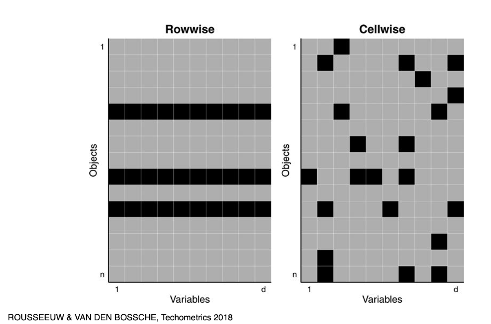
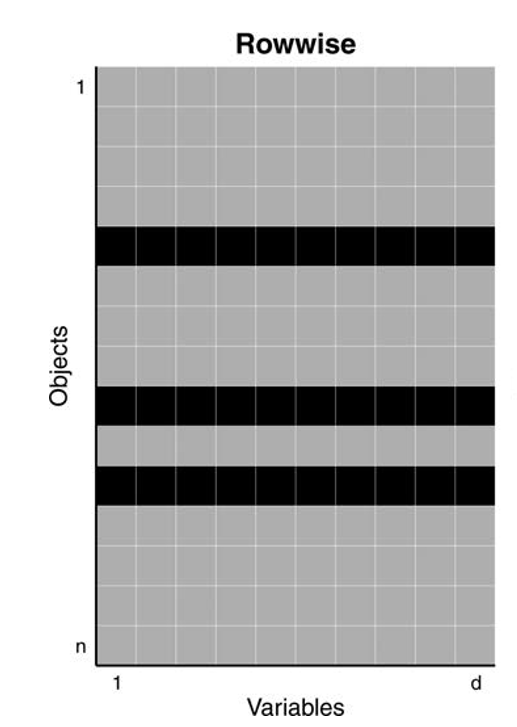
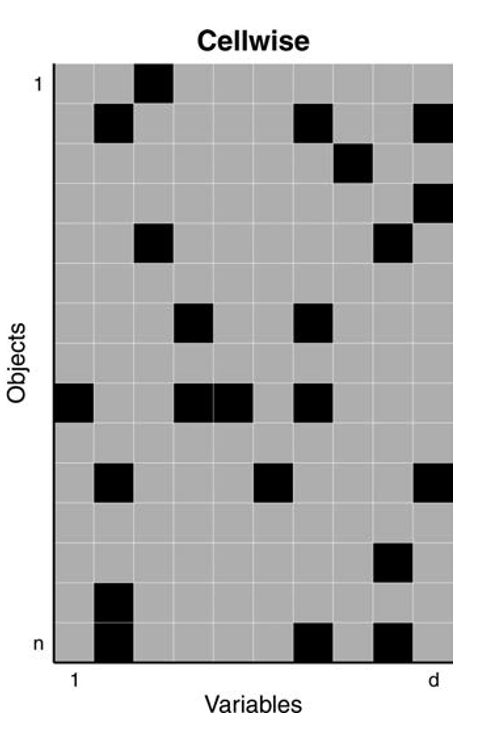
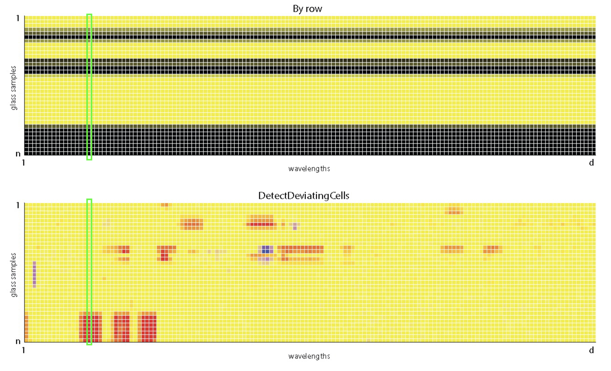



## Attribution
<br>

- Some examples and references are from [*Challenges of cellwise outliers*, by Raymaekers and Rousseeuw](https://www.sciencedirect.com/science/article/pii/S2452306224000078) 

- [*Robust Statistics*, by Maronna, Martin, Yohai, Salibian-Barrera](https://onlinelibrary.wiley.com/doi/book/10.1002/9781119214656)

<br>

*In memory of my mentor and friend*

Professor Ruben Zamar (1949-2023)

who contributed greatly to Robust Statistics and beyond ...

<br><br>

## Learning Objectives {.scrollable}

<br>
By the end of this lesson, you will be able to:

:::incremental
- Determine potential reasons why data contain outliers.
- Compare outliers with extreme values generated from heavy-tailed distributions.
- Recognize different types of outliers in a data set (e.g., casewise versus cellwise outliers).
- Use different methods to detect outliers in a data set and understand differences in the results.
- Justify and apply strategies for managing outliers in the data, including transformations and data imputation.
- Write a computer script to evaluate the impact that outliers can have on subsequent analyses through simulation.
- Reflect on the consequences with regards to the conclusions of the chosen method.
- Recognize the importance of utilizing domain knowledge when handling outliers.
:::

## What is an outlier?


## Outliers

::: {.callout-note title="Definition: Outlier"}
An **outlier** is an observation that deviates from the bulk of the data, an atypical observation. 
:::

#### Outliers may arise from:

- errors when collecting or processing data

- values generated from a different distribution

- rare cases which may carry valuable information

<br>

As with missing values, outliers require careful diagnosis and appropriate handling before analysis.

## Casewise *vs* Cellwise



## Casewise 

::: {.columns}

::: {.column width="45%"}

:::

::: {.column width="55%" .v-center}

<br><br>
In the 1960s Tukey and Huber introduced the *casewise* (aka rowwise) contamination model 

- Treats entire rows as contaminated and coming from a different distribution, even if only values of some variables are unusual

- Assumes that less than 50% of the cases (objects) are contaminated

:::
:::

## Cellwise

::: {.columns}

::: {.column width="45%"}

:::

::: {.column width="55%" .v-center}

<br><br>

In 2009, Alqallaf, Van Aelst, Yohai and Zamar introduced the *cellwise* contamination model

- Only individual cells are contaminated, with values coming from a different distribution

- Any case (row) may contain some contaminated cells

- More realistic for high-dimensional data

:::
:::

## Glass data



Data: n = 180 archeological glass spectra with d = 750 wavelengths ([Detecting Deviating Data Cells](https://www.tandfonline.com/doi/figure/10.1080/00401706.2017.1340909?scroll=top&needAccess=true), Rousseeuw & Van Den Bossche, *Technometrics* 2018)

## Univariate estimators

Before analyzing multivariate datasets, we first need to learn how to identify and handle outlying values in a single variable.

Let's look at the values of the wavelength V169 in this data

```{r echo=FALSE}
library(robustbase)
library(cellWise)
library(ggplot2)
data(data_glass)
df <- data.frame(x = data_glass[,"V169"])

ggplot(df, aes(x = x)) +
  geom_histogram(bins = 40, fill = "grey80", color = "white") +
  geom_vline(aes(xintercept = mean(x), color = "Mean"), linewidth = 1) +
  geom_vline(aes(xintercept = median(x), color = "Median"), linewidth = 1) +
  scale_color_manual(values = c(Mean = "red", Median = "blue")) +
  labs(title = "Wavelet Glass Spectra",
       x = "Coefficient value",
       y = "Count",
       color = NULL) +
  theme_minimal()
```

## Robust estimators

- Classical estimators can be highly distorted by outliers

- Robust estimators are needed to capture the bulk of the data

- Robust estimators are also needed to flag outliers

<br>

| Statistic | Estimate |
|-----------|----------|
| Mean      | `r round(mean(df$x),2)` |
| Median    | `r round(median(df$x),2)` |
| SD        | `r round(sd(df$x),2)` |
| MAD       | `r round(mad(df$x),2)` |

<br>

#### The mean and SD are very sensitive to the outliers in the data

## Mean ($\bar{X}$) *vs* Median ($\tilde{X}$)

If the median is less sensitive, why not using it as a default?

- if the data contain outliers, the median is more resistant

- but if the data do not contain outliers, it is less efficient (larger standard error!)

#### Under some conditions 

$$SE(\bar{X}) = \frac{\sigma}{\sqrt{n}}$$

####  and under Normality:

$$SE(\tilde{X}) \approx \sqrt{\frac{\pi}{2}}\frac{\sigma}{\sqrt{n}}$$

Let's examine these two points by simulation!

## Simulation: clean data

- Generate a sample of size 100 from a Normal distribution with mean 0 and standard deviation 1

- Compute the mean and the median

- Repeat 10000 times

- Summarize their sampling distributions


##

```{r}
set.seed(200)

sim_stats <- replicate(10000, {
  x <- rnorm(100)
  c(mean = mean(x),
    median = median(x))
})

sim_stats <- t(sim_stats) |> as.data.frame()

sd(sim_stats$mean)
1/sqrt(100)

sd(sim_stats$median)
sqrt(pi/2)*0.1
```

##

```{r echo=FALSE}
set.seed(200)

sim_stats <- replicate(10000, {
  x <- rnorm(100)
  c(mean = mean(x),
    median = median(x))
})

sim_stats <- t(sim_stats) |> as.data.frame()

ggplot(sim_stats) +
  geom_histogram(aes(x = mean, fill = "Mean"),
                 bins = 50, alpha = 0.35, color = NA) +
  geom_histogram(aes(x = median, fill = "Median"),
                 bins = 50, alpha = 0.35, color = NA) +
  scale_fill_manual(values = c(Mean = "#E41A1C",
                               Median = "#377EB8")) +
  labs(title = "Sampling distributions: mean vs median (Normal data)",
       x = "Statistic value",
       y = "Frequency",
       fill = NULL) +
  theme_minimal(base_size = 14)
```


## Relative Efficiency

- **Relative efficiency (RE)** compares the precision of an estimator with that of the sample mean.

$$
\operatorname{RE}(\hat\theta,\bar X)
= \frac{\operatorname{Var}(\bar X)}
       {\operatorname{Var}(\hat\theta)}
$$

- **RE < 1:** Less precise than the mean (larger variance).
- **RE = 1:** Same precision as the mean.
- **RE > 1:** More precise than the mean (smaller variance).

## RE under normality:

$$
\operatorname{ARE}(\tilde X,\bar X)
\approx \frac{\sigma^2/n}{\sigma^2\pi/(2n)}
= \frac{2}{\pi} \approx 0.64
$$


### By simulation:

<br>

```{r}
# Simulated relative efficiency of the median
var(sim_stats$mean) / var(sim_stats$median)
```

<br>

::: {.fragment}
### Takeaway:

**Under normality**, the median is less efficient than the sample mean.
:::

## Mean ($\bar{X}$) *vs* Median ($\tilde{X}$) under contamination

- if the data contain outliers, the median is more resistant

- and more efficient (smaller standard error!)

#### Under some conditions:

$$\text{Var}(\bar{X}) = \frac{(1-\varepsilon)\sigma^2_1 + \varepsilon \sigma_2^2}{n}$$

$$\mathrm{Var}(\tilde{X}) \approx \frac{\pi}{2n}\;
\frac{1}{\left(\frac{1-\varepsilon}{\sigma_1}+\frac{\varepsilon}{\sigma_2}\right)^2}$$

Let's explore this by simulation

## Simulation: contaminated data

- Generate a sample of size 100, with 90% from $\mathcal{N}(0,1)$ and 10% from $\mathcal{N}(0,10)$

- Compute the mean and the median

- Repeat 10000 times

- Summarize their sampling distributions

##

```{r}
rcont_norm <- function(n, eps = 0.10, mu0 = 0, 
                       sigma0 = 1, sigma1 = 10) {
  x <- rnorm(n, mean = mu0, sd = sigma0)
  
  k <- ceiling(eps * n)              
  if (k > 0) {
    idx <- sample(1:n, k)
    x[idx] <- rnorm(k, mean = mu0, sd = sigma1)
  }
  x
}

set.seed(200)

sim_cont_stats <- replicate(10000, {
  x <- rcont_norm(100)
  c(mean = mean(x),
    median = median(x))
})

sim_cont_stats <- t(sim_cont_stats) |> as.data.frame()

sd(sim_cont_stats$mean)
sd(sim_cont_stats$median)
dd <- (.9/1 + .1/10)^2
sqrt(pi/(2*100*dd))
```

## RE by simulation:

<br>

```{r echo=FALSE}
rcont_norm <- function(n, eps = 0.10, mu0 = 0, 
                       sigma0 = 1, sigma1 = 10) {
  x <- rnorm(n, mean = mu0, sd = sigma0)
  
  k <- ceiling(eps * n)              
  if (k > 0) {
    idx <- sample(1:n, k)
    x[idx] <- rnorm(k, mean = mu0, sd = sigma1)
  }
  x
}

set.seed(200)

sim_cont_stats <- replicate(10000, {
  x <- rcont_norm(100)
  c(mean = mean(x),
    median = median(x))
})

sim_cont_stats <- t(sim_cont_stats) |> as.data.frame()
```

```{r}
# Simulated relative efficiency of the median
var(sim_cont_stats$mean) / var(sim_cont_stats$median)
```

<br>

::: {.fragment}
### Takeaway:

**Under contamination**, the median is more efficient than the sample mean.
:::

## Robustness *vs* Efficiency
<br>


<br>

## Can we achieve robustness without loss of efficiency?

In general, we don't know the distribution that generated our data. 

It may even be a mixture of distributions that generated contaminated data!

```{r echo=FALSE}
set.seed(1)

# Mixture parameters
w1 <- 0.9
w2 <- 0.1
mu1 <- 2
mu2 <- 5
sigma <- 1
n <- 60

# Sample from mixture
z <- rbinom(n, 1, w2)
x <- rnorm(n, mu1, sigma)
x[z == 1] <- rnorm(sum(z == 1), mu2, sigma)
dat <- tibble(x = x)

# Density grid
grid <- tibble(x = seq(-1, 8, length.out = 600)) |>
  mutate(
    comp1 = w1 * dnorm(x, mu1, sigma),
    comp2 = w2 * dnorm(x, mu2, sigma),
    mix   = comp1 + comp2
  )

grid_long <- grid |>
  pivot_longer(cols = c(mix, comp1, comp2),
               names_to = "curve",
               values_to = "density") |>
  mutate(curve = factor(
    curve,
    levels = c("mix", "comp1", "comp2"),
    labels = c("Mixture", "0.9 × N(2,1)", "0.1 × N(5,1)")
  ))

ggplot() +
  geom_line(
    data = grid_long,
    aes(x = x, y = density, color = curve, linewidth = curve)
  ) +
  scale_color_manual(
    values = c(
      "Mixture" = "black",
      "0.9 × N(2,1)" = "#0072B2",  # blue
      "0.1 × N(5,1)" = "#D55E00"   # vermillion
    )
  ) +
  scale_linewidth_manual(
    values = c("Mixture" = 1.3, "0.9 × N(2,1)" = 1, "0.1 × N(5,1)" = 1)
  ) +
  geom_point(
    data = dat,
    aes(x = x, y = -0.01),
    size = 2.5,
    color = "black"
  ) +
  coord_cartesian(ylim = c(-0.03, max(grid$mix))) +
  labs(x = "x", y = "density") +
  theme_minimal(base_size = 14) +
  theme(
    panel.grid = element_blank(),
    axis.line = element_line(color = "black"),
    legend.title = element_blank()
  )
```

## The M-estimators

The sample mean is the maximum likelihood estimator under Normality:

$$
\bar{X} = \hat{\mu}_{\text{MLE}}
=
\arg\min_{\mu}
\sum_{i=1}^n
\!(x_i-\mu)^2
$$
From the MLE to the M-estimator:

$$
\hat{\mu}_M
=
\arg\min_{\mu}
\sum_{i=1}^n
\rho(x_i-\mu)
$$

#### Instead of of squaring deviations, we measure them with a differentiable function $\rho$

## The $\rho$ function

<br>

| Robustness *vs* Efficiency|  | $\rho(r)$  | | Estimator | 
|---|--|---|--|---|
| {width=200} | |square | | Mean |
| {width=200} | |absolute | |Median |
| &nbsp;<br> {width=200} | | &nbsp;<br><br>  differenciable? | | &nbsp;<br><br>  M-estimator |


## 

Different $M$-estimators of location have been proposed:

```{r}
library(ggplot2)
library(tidyverse)
library(robustbase)

# grid
x <- seq(-6, 6, length.out = 400)

df <- tibble(
  x = x,
  Mean     = 0.5 * x^2,
  Median   = abs(x),
  Huber    = Mpsi(x, psi = "huber",    cc = 1.5,   deriv = -1),
  Bisquare = Mpsi(x, psi = "bisquare", cc = 4.685, deriv = -1)) |>
  pivot_longer(-x, names_to = "type", values_to = "rho") |>
  mutate(type = factor(type, levels = c("Mean", "Huber", "Median", "Bisquare"))
  )

cc_lines <- tibble(
  type = c("Huber", "Huber", "Bisquare", "Bisquare"),
  xint = c(-1.5, 1.5, -4.685, 4.685)) |>
  mutate(type = factor(type, levels = levels(df$type)))

ggplot(df, aes(x, rho)) +
  geom_line(linewidth = 1) +
  geom_vline(
    data = cc_lines,
    aes(xintercept = xint),
    linetype = "dashed",
    linewidth = 0.6) +
  facet_wrap(~ type, ncol = 2, scales = "free_y") +
  labs(x = "x", y = expression(rho(x))) +
  theme_minimal(base_size = 14)
```


## The Huber M-estimator

- quadratic near 0 and linear in the tails, with cutoff \(c\).

**RE compared with the sample mean**:

| $c$ | Estimator | Normality | 10% Contamination |
|---:|:---|---:|---:|
| $0$ | Median (limiting case) | 0.64 | 5.75 |
| $1.0$ | Huber M | 0.90 | 7.55 |
| **$1.345$** | **Huber M** | **0.95** | **7.57** |
| $2.0$ | Huber M | 0.99 | 7.04 |
| $\infty$ | Mean | 1.00 | 1.00 |


- **Under normality:** Larger $c$ gives higher efficiency.
- **$c=1.345$:** Maintains 95% efficiency under normality while providing strong resistance to outliers.

## Computing M-estimators

To compute a robust M-estimators of location, we typically also need an estimate of the spread ($\sigma$, aka scale) of the distribution.

- The SD is efficient but not robust to outliers 

- The MAD (median absolute deviation) is highly robust:

$$1.4826 \, \text{median}(|x_i - \text{median}|)$$ 

- We can define an M-estimator for the scale (M-scale)

- We can also estimate location and scale jointly via M-estimation

## In R

- `mad(x)` computes the MAD

- `locScaleM(x)` in `RobStatTM` computes Huber and bisquare M-estimators (jointly for location and scale) at various (asymptotic) efficiency values

## Simulation design

- Clean data: Generate a sample of size 100 from a Normal distribution with mean 0 and standard deviation 1

- Contaminated data: Generate a sample of size 100, with 90% from $\mathcal{N}(0,1)$ and 10% from $\mathcal{N}(0,10)$

- Compute the mean, the median, two bisquare-M estimators (one at 85% and another one at 95% efficiency)

- Repeat 1000 times

- Approximate the variance of the estimators


## Without and with contamination

```{r}
library(RobStatTM)
set.seed(200)

rcont_norm <- function(n, eps = 0.10, mu0 = 0, sigma0 = 1, sigma1 = 10) {
  x <- rnorm(n, mean = mu0, sd = sigma0)
  
  k <- ceiling(eps * n)              
  if (k > 0) {
    idx <- sample(1:n, k)
    x[idx] <- rnorm(k, mean = mu0, sd = sigma1)
  }
  x
}

#no contamination

eps = 0
sim <- replicate(1000, {
    x <- rcont_norm(100, eps = eps)
    c(
      Mean     = mean(x),
      Median   = median(x),
      Bisquare_3.44 = locScaleM(x, psi="bisquare", eff=0.85)$mu,
      Bisquare_4.68 = locScaleM(x, psi="bisquare", eff=0.95)$mu
    )
  })

  
var0  <- apply(t(sim), 2, var)

# with contamination
eps = 0.20
sim <- replicate(1000, {
    x <- rcont_norm(100, eps = eps)
    c(
      Mean     = mean(x),
      Median   = median(x),
      Bisquare_3.44 = locScaleM(x, psi="bisquare", eff=0.85)$mu,
      Bisquare_4.68 = locScaleM(x, psi="bisquare", eff=0.95)$mu
    )
  })
  
var20 <- apply(t(sim), 2, var)
```

##

```{r}
variance_table <- cbind(
  "No contamination" = var0,
  "20% contamination" = var20
)

knitr::kable(
  variance_table,
  digits = 4,
  caption = "Sampling variance of location estimators"
)
```

**Relative efficiency (RE)** can be computed as the ratio of the variances of two estimators under the same conditions.

## Key Takeaways

<br>

- Outliers can occur in all variables of an observation or only in certain variables

- Cellwise paradigm is better is more flexible for high-dimensional data

- Classical estimators can be optimal but very sensitive to outliers

- Median is less efficient than the mean (≈ 1.57 × variance_mean) under normality but more stable and efficient under contamination

- Robustness = trade-off with efficiency

- M-estimators offer a compromise between efficiency under normality and robustness to contamination.


