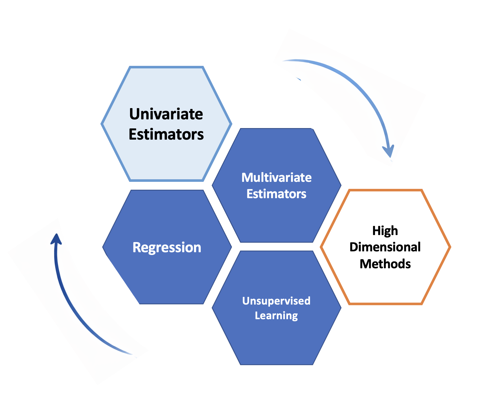
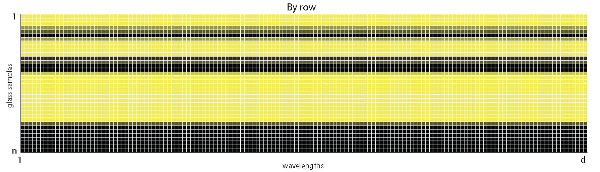
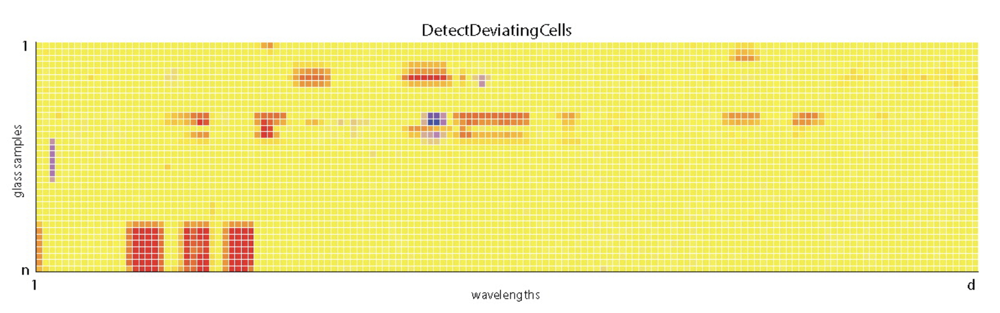
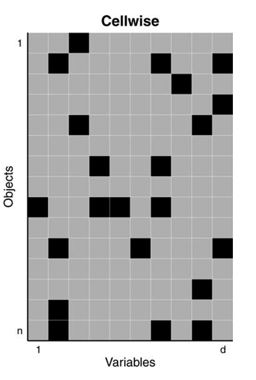
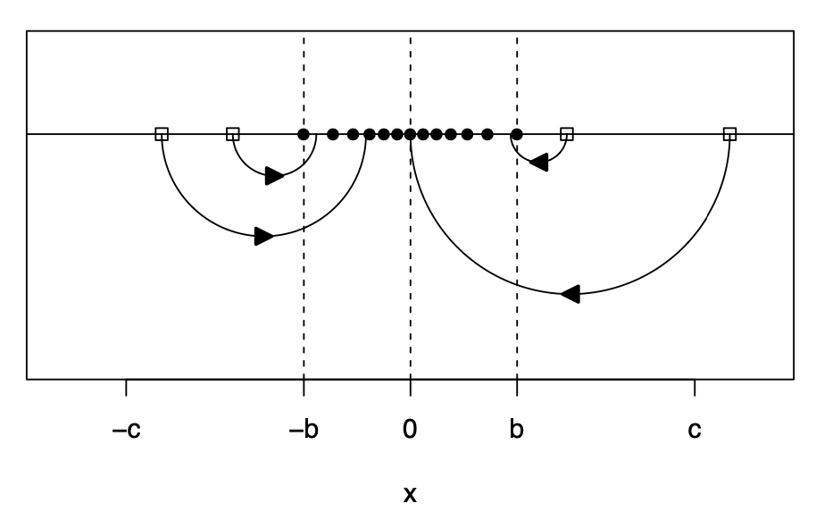



## Attribution

<br>

-   Some examples and references are from [*Challenges of cellwise outliers*, by Raymaekers and Rousseeuw](https://www.sciencedirect.com/science/article/pii/S2452306224000078)

-   [*Robust Statistics*, by Maronna, Martin, Yohai, Salibian-Barrera](https://onlinelibrary.wiley.com/doi/book/10.1002/9781119214656)

<br>

*In memory of my mentor and friend*

Professor Ruben Zamar (1949-2023)

who contributed greatly to Robust Statistics and beyond ...

<br><br>


## Review {.scrollable}

- An **outlier** is an observation that deviates from the bulk of the data, an atypical observation.
- We defined both casewise and cellwise outliers in a dataset, but focused on **univariate outliers**.

- We examined by simulations three univariate estimators of location: the **mean**, the **median**, and the **M-estimators**.

- We learned about the trade-off between robustness and efficiency.
- We also learned about **masking** and robust outlier detection based on the **median** and **MAD**.

## From one variable to an entire dataset

::::: columns
::: {.column width="70%"}

:::
::: {.column width="30%"}

Three core tasks:

- **Estimating multivariate parameters** (e.g., location and covariance)
- **Modeling relationships** (e.g., regression)
- **Discovering structure** (e.g., unsupervised learning)

:::
:::::

## Goal for today

1. How do we detect outliers when we have several variables?
2. What happens when outliers affect **regression**? Can M-estimators help?
2. Identify different type of outliers: rowwise, cellwise and outlies in regression
3. Why do **cellwise** outliers need different tools?

## From one variable to many variables

<br>

### For one variable, we describe:

- **center**: mean, median
- **spread**: variance, SD, MAD

### For several variable, we describe:

- **multivariate center**: the typical combination of values across variables.

- **multivariate scatter**: how observations spread around the center, accounting for relationships between variables.

##

```{r echo=FALSE, include=FALSE}
library(cellWise)
library(dplyr)
library(ggplot2)
library(tidyr)
library(robustbase)
library(GGally)
library(rlang)

library(RobStatTM)

data(data_glass)

glass_df <- as.data.frame(data_glass)
```

```{r echo=FALSE}
X <- glass_df[, c("V30","V61")]

mcd <- covMcd(X)
md <- mahalanobis(X, mcd$center, mcd$cov)
cut <- qchisq(0.9, 2)

mult_MCD <- ggplot(X, aes(V30, V61)) +
  geom_point(color="grey60") +
  stat_ellipse(
    type="norm",
    level=0.9,
    segments=200,
    color="blue"
  ) +
  annotate("point",
           x=mcd$center[1],
           y=mcd$center[2],
           color="red",
           size=4)
mult_MCD
```

#### The center locates the data cloud, while scatter describes its shape and orientation.

## Robust multivariate estimators

We want to estimate the center and spread of the data without being overly influenced by outliers.

**Two possible strategies:**

- 1. **M-estimators**: give less weight to observations that are far from the main cloud of data, reducing their influence on the estimated center and scatter.

- 2. **Minimum covariace determinant (MCD)**: select the 50% of observations (or other) that form the most compact multivariate cloud. Estimate the center and spread using that group.

::: {.callout-tip title="Important"}
Unlike **coordinate-wise** estimates and **pairwise** correlations, these methods consider all variables jointly to estimate the center and scatter.
:::

##

```{r}
X <- glass_df[, c("V29", "V30", "V125", "V175", "V180")]

# Classical estimates
center_mean <- colMeans(X)
center_median <- sapply(X, median)
cov_classical <- cov(X)
cor_classical <- cor(X)

# Robust estimates (MCD)
mcd <- robustbase::covMcd(X)
center_MCD <- mcd$center
cov_MCD <- mcd$cov
cor_MCD <- mcd$cor

# Multivariate MM-estimator
mest <- covRob(as.matrix(X), type = "MM", corr = TRUE)

center_MMest <- mest$center
cov_MMest <- mest$cov
cor_MMest <- mest$cor

# Compare estimated centers
round(rbind(
  Mean = center_mean,
  Median = center_median,
  MM = center_MMest,
  MCD = center_MCD
), 2)

```

##

```{r echo=FALSE}
#| layout-ncol: 3
#| fig-width: 4
#| fig-height: 4

# Correlation matrices
cor_classical <- cov2cor(cov_classical)
cor_mcd <- cov2cor(cov_MCD)
cor_mm <- cov2cor(cov_MMest)

# Classical
corrr::rplot(corrr::as_cordf(cor_classical),
             print_cor = TRUE, legend = FALSE) +
  ggtitle("Classical")

# MCD
corrr::rplot(corrr::as_cordf(cor_mcd),
             print_cor = TRUE, legend = FALSE) +
  ggtitle("MCD")

# MM
corrr::rplot(corrr::as_cordf(cor_mm),
             print_cor = TRUE, legend = FALSE) +
  ggtitle("MM")
```

- **V125–V175**: the apparent positive relationship largely disappears with robust estimation.

- **V175–V180**: The correlation remains very strong across all methods.


### Unusual observations can strongly affect estimated correlations when using classical estimators.

# Rowwise outliers

**How can we identify observations far from the main cloud?**



## Distance measure

### For univariate detection: a robust z-score

$$z_i^{\text{rob}} = \frac{x_i-\text{median}}{\text{MAD}}$$

### For multivariate detection: the Mahalanobis distance

- We need a distance measure that accounts for the variability of each variable and the relationships between variables.

::: {.columns}

::: {.column width="55%"}
  - Accounting for how the data vary, being far from the center does not necessarily mean being unusual.
  
  - Using robust estimates of center and scatter can help control masking.
:::  

::: {.column width="45%"}

```{r echo = FALSE}
mult_MCD
```

:::
:::

::: {.callout-tip title="Important"}
An observation can be unusual **jointly** even if none of its individual values is extreme.
:::


## Detecting rowwise outliers

- We can use the **MCD** or **MM-** estimates to calculate robust Mahalanobis distances (MD) of each data point.

- The threshold is determined based on how this distance is expected to behave when the data follow a Normal distribution.


```{r}
# MCD estimator
mcd <- covMcd(X)
md <- mahalanobis(X, mcd$center, mcd$cov)
cutoff <- qchisq(0.975, ncol(X))

md_df <- data.frame(
  obs = seq_along(md),
  rob_MD = md,
  flagged = md > cutoff)
```


##

```{r}
ggplot(md_df, aes(x = obs, y = rob_MD)) +
  geom_point(aes(shape = flagged, color = flagged), size = 2) +
  scale_shape_manual(values = c(16, 17)) +
  scale_color_manual(values = c("black", "blue")) +
  geom_hline(yintercept = cutoff, linetype = "dashed")
```

#### Data points (rows) with a squared MD exceeding the cutoff are flagged as rowwise outliers


# Cellwise outliers

**What if only a few values per observation are unusual in a row?**



##

::: columns

::: {.column width="55%"}
<br>

### Cellwise outliers

- In high-dimensional data, contamination often occurs cell by cell, not row by row.
- Every row may contain at least one bad entry
- Removing or downweighting entire rows with rowwise methods may discard useful information.

<br>

#### **Wrapping** extends the idea of robust estimation to individual cells.

:::
::: {.column width="45%"}

:::
:::

## Robust correlation by wrapping {.scrollable}

In the spirit of Huber's estimation, wrapping have been proposed to compute robust correlations (fast): 

<br>

::: columns

::: {.column width="55%"}


- 1. robustly standardize each variable

- 2. transform extreme values with a bounded function

- 3. compute ordinary correlations on the transformed data

:::
::: {.column width="45%"}




:::
:::


So we keep the speed and structure of classical correlation, but gain robustness.

<br>

::: {style="font-size: 13px; margin-top: -30px; color: grey;"}

from Raymaekers, J., and Rousseeuw, P.J, (Technometrics 2021)
:::

## Estimation and wrapping

```{r}
locScaleX <- estLocScale(X, precScale = 1e-12)

Xw  <- wrap(data_filled, locScaleX$loc, locScaleX$scale)$Xw
```

## Detecting cellwise outliers

<br>

#### DDC: Detect Deviating Cells

DDC combines robust correlation and regression to flag outlying cells.

- **Robust correlations** identify related variables.
- **Robust regressions** estimate relationships between pairs of variables.
- These relationships are used to predict individual cell values.
- Cells that deviate substantially from their predictions are flagged.
- Missing and flagged values can be replaced by predicted values.

#### DDC identifies unusual cells without discarding entire rows.


## Applying DDC to the Glass data

<br>

```{r}
# Run the fast DDC algorithm
fastDDCglass <- DDC(X, list(fastDDC = TRUE, silent = TRUE))

# Create the cell map
ggpfastDDC <- cellMap(
  R = fastDDCglass$stdResid,
  indcells = fastDDCglass$indcells,
  indrows = fastDDCglass$indrows,
  nrowsinblock = 5,
  mTitle = "",
  columnangle = 90
)
```

- `stdResid`: standardized differences between observed and predicted values.
- `indcells`: cells flagged as unusual.
- `indrows`: rows flagged as unusual.


## The cell map

Let's visualize the suspicious entries in the Glass data.

```{r}
#| echo: false
#| fig-width: 10
#| fig-height: 5.2
#| out-width: "90%"
#| fig-align: center

ggpfastDDC + ggplot2::coord_fixed(ratio = 0.08)
```

**Yellow:** regular cells. **Red:** unusually high values. **Blue:** unusually low values.


# Outliers in regression

## From multivariate outliers to regression

```{r echo=FALSE}
# Search a subset of wavelengths
vars <- paste0("V", seq(20, 200, by = 5))

pairs <- combn(vars, 2, simplify = FALSE)

rob_z <- function(x) {
  (x - median(x)) / mad(x)
}

check_pair <- function(v) {
  x <- glass_df[[v[1]]]
  y <- glass_df[[v[2]]]

  fit <- MASS::rlm(y ~ x, maxit = 100)

  zx <- rob_z(x)
  zy <- rob_z(y)
  zr <- rob_z(residuals(fit))

  # Joint anomalies that are not marginal outliers
  joint <- abs(zx) < 2.5 &
           abs(zy) < 2.5 &
           abs(zr) > 3

  data.frame(
    x = v[1],
    y = v[2],
    correlation = cor(x, y),
    n_joint = sum(joint),
    max_residual = if (any(joint))
      max(abs(zr[joint])) else NA_real_
  )
}

results <- bind_rows(lapply(pairs, check_pair))

#results |>
#  filter(n_joint > 0, abs(correlation) > 0.6) |>
#  arrange(desc(n_joint), desc(max_residual)) |>
#  head(15)
```


```{r echo = FALSE}
plot_df <- rbind(
  data.frame(x = glass_df$V29,  y = glass_df$V30,  pair = "V29 vs V30"),
  data.frame(x = glass_df$V125, y = glass_df$V175, pair = "V125 vs V175"),
  data.frame(x = glass_df$V175, y = glass_df$V180, pair = "V175 vs V180")
)

three_panel_reg <- ggplot(plot_df, aes(x = x, y = y)) +
  geom_point(color = "grey65", shape = 16, size = 1.5) +
  geom_smooth(
    aes(color = "Least squares"),
    method = "lm", formula = y ~ x,
    se = FALSE, linewidth = 1
  ) +
  geom_smooth(
    aes(color = "Robust regression"),
    method = robustbase::lmrob, formula = y ~ x,
    se = FALSE, linewidth = 1
  ) +
  scale_color_manual(
    values = c(
      "Least squares" = "steelblue2",
      "Robust regression" = "seagreen3"
    ),
    name = NULL
  ) +
  facet_wrap(~ pair, scales = "free", nrow = 1) +
  labs(x = "X", y = "Y") +
  theme_minimal(base_size = 14) +
  theme(legend.position = "bottom")
```

```{r}
three_panel_reg
```

### Outliers can strongly influence regression estimates

## Least squares regression 

$$
\begin{equation*}
\frac{1}{n} \ \sum_{i=1}^n (\underbrace{y_i - {\color{blue}{a}} - {\color{blue}{b}} x_i 
}_{\text{Residual}})^2 
\end{equation*}
$$

- LS finds ${\color{blue}{a}}$ and ${\color{blue}{b}}$ that minimizes the sum of the squared residuals.

- Points with large residuals contribute heavily to the sum of squared residuals, pulling the LS fit toward them.

<br>

<br>

<br>

<br>

<br>

::: {style="font-size: 13px; margin-top: -30px; color: grey;"}

Attribution: slides 23-25 are based on lecture notes from Prof. Salibian-Barrera
:::

##

```{r echo=FALSE}
dat <- as_tibble(X) |>
  select(V125, V175) |>
  drop_na()

set.seed(123)

m.ls  <- lm(V175 ~ V125, data = dat)
m.rob <- lmrob(V175 ~ V125, data = dat)

# Identify unusual and regular observations
dat <- dat |>
  mutate(resid_rob = V175 - predict(m.rob))

unusual <- dat |>
  slice_max(resid_rob, n = 2, with_ties = FALSE) |>
  mutate(type = "Unusual")

regular <- dat |>
  filter(abs(resid_rob) < median(abs(resid_rob))) |>
  slice_max(V125, n = 2, with_ties = FALSE) |>
  mutate(type = "Regular")

selected <- bind_rows(unusual, regular)


plot_reg <- function(model, line_color) {

  arrow_data <- unusual |>
    mutate(fitted = as.numeric(predict(model, newdata = unusual)))

  ggplot(dat, aes(x = V125, y = V175)) +
    geom_point(color = "gray65", size = 1.8) +
    geom_abline(
      intercept = coef(model)[1],
      slope = coef(model)[2],
      color = line_color,
      linewidth = 1.2
    ) +
    geom_segment(
      data = arrow_data,
      aes(xend = V125, yend = fitted),
      color = "orange",
      arrow = grid::arrow(
        ends = "both",
        length = grid::unit(0.10, "in")
      ),
      linewidth = 0.8
    ) +
    coord_cartesian(
      xlim = c(50, 175),
      ylim = c(1400, 3500)
    ) +
    labs(x = "V125", y = "V175") +
    theme_minimal(base_size = 15) +
    theme(
      aspect.ratio = 1.2,
      panel.grid.minor = element_blank()
    )
}


```


::: columns

::: {.column width="50%"}

#### Least squares: 
Minimizes the sum of squared residuals.

```{r echo=FALSE}
#| fig-width: 5
#| fig-height: 5.5
#| out-width: "100%"

plot_reg(m.ls, line_color = "steelblue2")
```

:::

::: {.column width="50%"}

#### Robust regression: 
Limits the influence of large residuals.

```{r echo=FALSE}
#| fig-width: 5
#| fig-height: 5.5
#| out-width: "100%"

plot_reg(m.rob, line_color = "forestgreen")
```

:::

:::


## Robust regression (for rowwise outliers)

#### **M-estimators** 
Replace square with a robust function $\rho(r)$ to limit the influence of outliers.

> when $\sigma$ is unknown, we can use MM-estimation, which first estimates the scale robustly.

$$
\begin{equation*}
\frac{1}{n} \ \sum_{i=1}^n \rho \left(\frac{y_i - {\color{blue}{a}} - {\color{blue}{b}} x_i 
}{\sigma}\right) 
\end{equation*}
$$

#### Least Trimmed Squares (LTS)
Minimizes the sum of the 50% smallest squared residuals (or other proportion).

##

```{r}
set.seed(123)

reg_ls  <- lm(V175 ~ V125, data = dat)
reg_mm <- lmrob(V175 ~ V125, data = dat)
reg_lts <- ltsReg(V175 ~ V125, data = dat, alpha = 0.5)

```

```{r echo=FALSE}
# Extract coefficients
fits <- tibble(
  Method = c("Least squares", "MM-estimation", "LTS"),
  intercept = c(coef(reg_ls)[1],
                coef(reg_mm)[1],
                reg_lts$raw.coefficients[1]),
  slope = c(coef(reg_ls)[2],
            coef(reg_mm)[2],
            reg_lts$raw.coefficients[2])
)

# Plot the three regression lines
ggplot(dat, aes(V125, V175)) +
  geom_point(color = "gray65", size = 1.5) +
  geom_abline(
    data = fits,
    aes(intercept = intercept, slope = slope,
        color = Method),
    linewidth = 1.2,
    inherit.aes = FALSE
  ) +
  scale_color_manual(values = c(
    "Least squares" = "steelblue2",
    "MM-estimation" = "forestgreen",
    "LTS" = "orange"
  )) +
  coord_cartesian(xlim = c(50, 175),
                  ylim = c(1400, 3500)) +
  labs(x = "V125", y = "V175", color = NULL) +
  theme_minimal(base_size = 15)
```


::: {style="font-size: 13px; margin-top: -30px; color: grey;"}

Attribution: based on lecture notes from Prof. Salibian-Barrera
:::


## Outliers detection in regression

```{r}

# Add observation numbers
dat <- dat |>
  mutate(id = row_number())

# Compute fitted values and standardized residuals
diag_dat <- bind_rows(
  dat |>
    mutate(
      Method = "Least squares",
      fitted = fitted(reg_ls),
      std_resid = resid(reg_ls) / sigma(reg_ls)
    ),
  dat |>
    mutate(
      Method = "MM-estimation",
      fitted = fitted(reg_mm),
      std_resid = resid(reg_mm) / reg_mm$scale
    ),
  dat |>
    mutate(
      Method = "LTS",
      fitted = reg_lts$raw.coefficients[1] +
               reg_lts$raw.coefficients[2] * V125,
      std_resid = (V175 - fitted) / reg_lts$raw.scale
    )
) |>
  mutate(
    Method = factor(Method,
      levels = c("Least squares", "MM-estimation", "LTS")),
    flag = abs(std_resid) > 2.5
  )

# Select observations to label
lab_dat <- diag_dat |>
  filter(flag) |>
  group_by(Method) |>
  slice_max(abs(std_resid), n = 3, with_ties = FALSE) |>
  ungroup()

```

##

```{r echo = FALSE}

# Plot

ggplot(diag_dat, aes(x = fitted, y = std_resid)) +
  geom_hline(
    yintercept = 0,
    linetype = "dashed",
    color = "gray50"
  ) +
  geom_hline(
    yintercept = c(-2.5, 2.5),
    linetype = "dotted",
    color = "gray60"
  ) +
  geom_point(
  aes(color = flag, shape = flag),
  size = 2,
  alpha = 0.85
) +
scale_shape_manual(
  values = c("FALSE" = 16, "TRUE" = 17),
  guide = "none"
) +
  scale_color_manual(
    values = c("FALSE" = "gray65", "TRUE" = "blue"),
    labels = c("Regular", "Flagged"),
    name = NULL
  ) +
  facet_wrap(~Method, nrow = 1, scales = "free_x") +
  coord_cartesian(ylim = c(-3.5, 10)) +
  labs(
    x = "Fitted values",
    y = "Standardized residuals"
  ) +
  theme_minimal(base_size = 16) +
  theme(
    aspect.ratio = 1,
    panel.grid.minor = element_blank(),
    strip.text = element_text(face = "bold", size = 15),
    legend.position = "bottom"
  )

```

#### Least squares can mask outliers because they pull the fitted line toward themselves, reducing their residuals.

## Regression outliers: residuals and leverage

- **Vertical residual**: an observation far **vertically** from the fitted line.
- **High-leverage observation** has an unusual value of the **predictor**, good or bad, depending on whether they follow the main data pattern.

```{r echo = FALSE}
plot_df <- rbind(
  data.frame(x = glass_df$V125, y = glass_df$V175, pair = "V125 vs V175"),
  data.frame(x = glass_df$V175, y = glass_df$V180, pair = "V175 vs V180")
)

two_panel_reg <- ggplot(plot_df, aes(x = x, y = y)) +
  geom_point(color = "grey65", shape = 16, size = 1.5) +
  geom_smooth(
    aes(color = "Least squares"),
    method = "lm", formula = y ~ x,
    se = FALSE, linewidth = 1
  ) +
  geom_smooth(
    aes(color = "Robust regression"),
    method = robustbase::lmrob, formula = y ~ x,
    se = FALSE, linewidth = 1
  ) +
  scale_color_manual(
    values = c(
      "Least squares" = "steelblue2",
      "Robust regression" = "seagreen3"
    ),
    name = NULL
  ) +
  facet_wrap(~ pair, scales = "free", nrow = 1) +
  labs(x = "X", y = "Y") +
  theme_minimal(base_size = 14) +
  theme(legend.position = "bottom")
```

```{r}
two_panel_reg
```


## Key Takeaways

- In both univariate and multivariate cases, classical estimators can be sensitive to outliers.
- Robust estimators reduce the influence of extreme observations, while aiming to maintain high efficiency under Normality.

- **Rowwise contamination**

  - Methods such as M-estimators and MCD estimate robust multivariate center and scatter
  
  - These estimates can be used to compute robust Mahalanobis distances to detect outliers

##

- **Cellwise contamination**

  - Methods such as DDC and wrapping detect corrupted cells 
  - They rely on relationships among variables and are used to compute robust multivariate estimates and flag outliers

- Robust methods improve both estimation and outlier detection

- **Regression:** 
  - M-estimators extend the robust-loss idea to residuals
  - LTS uses all data points to select a subset of points with smallest residuals
  - Outliers can be identified using residual plots from robust regression fits.
  - Large residuals and high leverage are different.
